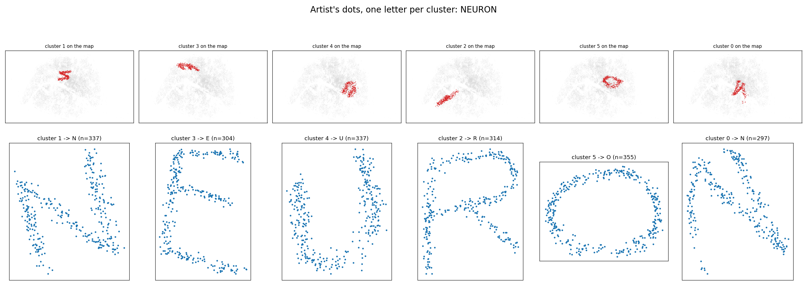

# France – Point par point

**Flag:** `SIGMOID_NEURON`

Files: [`solve.py`](solve.py) (code) · [`letters.png`](letters.png) (figure) · [`labels.csv`](labels.csv) (listing_id → cluster → letter)



## 1. Separate the artist's dots from the city
`paris_listings.csv` holds 28,108 listings with 18 columns. The listings are internally consistent (review counts, room types, neighbourhoods), so the fake rows can't be spotted from the data alone.

The real listings come from the public **Inside Airbnb Paris** file:
`https://data.insideairbnb.com/france/ile-de-france/paris/2026-09-16/data/listings.csv.gz`

Matching on exact (latitude, longitude):
- **26,163** rows match a real Inside Airbnb listing
- **1,945** rows don't. These are the artist's dots.

## 2. Find the letters ("their colours came from what every traveller weighs")
Among the fake dots, only these columns carry structure: `latitude`, `longitude`, `price`, `availability_365`, `reviews_per_month` (and `number_of_reviews_ltm`). A dot's neighbours predict them almost perfectly; the other columns are copied noise.

Features used: `lat, lon, log(price), availability_365, log(reviews_per_month)`, standardised.

**HDBSCAN** (`min_cluster_size=20, min_samples=5`) gives **6 clusters** of about 300 dots each, plus 1 noise point (grey).

## 3. Look at each letter
Each cluster lies on its own flat **2-D plane** inside the 5-D space; the 3rd PCA component holds only about 2% of the variance. A 2-D PCA (**not whitened**, so the true shape is kept up to rotation/mirroring) of each cluster draws its letter. Each letter is then rotated so it reads upright.

| cluster centre in Paris (lon, lat) | letter |
|---|---|
| 2.339, 48.874 | **N** |
| 2.319, 48.885 | **E** |
| 2.374, 48.856 | **U** |
| 2.301, 48.843 | **R** |
| 2.363, 48.866 | **O** |
| 2.352, 48.856 | **N** |

→ **NEURON**. It fits the event name too: a sigmoid is a neuron's activation function.

A first attempt used *whitened* PCA. That squashes each letter, so the shapes were misread (Z/N, R/G, U/R) and gave the wrong word ORANGE. Unwhitened PCA fixes it.

## Reproduce
```bash
curl -L -o data/listings.csv.gz https://data.insideairbnb.com/france/ile-de-france/paris/2026-09-16/data/listings.csv.gz
python3 solve.py paris_listings.csv data/listings.csv.gz
```
```
listings: 28108  matched real: 26163  artist dots: 1945
cluster sizes: {-1: 1, 0: 297, 1: 337, 2: 314, 3: 304, 4: 337, 5: 355}
labels.csv and letters.png written
WORD: NEURON
FLAG: SIGMOID_NEURON
```

## Notes
- The letter order isn't stored in any column. NEURON is the only word these six letters make (two N, E, U, R, O).
- Inside Airbnb updates its snapshot. Matching worked with the 2026-09-16 file; another snapshot may match slightly fewer real rows.
