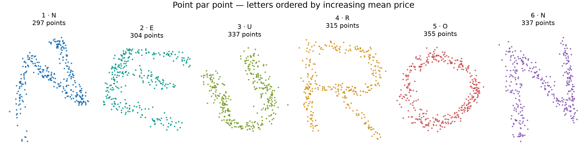
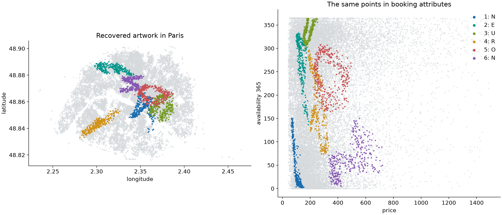

# Point par point — France

**Flag: `SIGMOID_NEURON`**

The recovered word is **N E U R O N**. The figure below consists of actual listing points, separated into six clusters and projected into two dimensions.



## Result

| Reading order | Letter | Points | Mean price (€) | Mean availability |
| --- | --- | ---: | ---: | ---: |
| 1 | N | 297 | 102.086 | 48.532 |
| 2 | E | 304 | 134.071 | 274.201 |
| 3 | U | 337 | 185.543 | 335.638 |
| 4 | R | 315 | 252.031 | 176.308 |
| 5 | O | 355 | 334.329 | 242.989 |
| 6 | N | 337 | 483.259 | 62.071 |

There are **1,945 artwork points** and **26,163 background/noise points**, accounting for all **28,108 input listings**. Ordering the recovered clusters by increasing mean price yields **NEURON**. This is the inferred reading order, supported by the resulting readable word; no organizer-provided order column is present.

## Recovery method

This is a **source-assisted solution**, followed by density clustering. It uses the public source dataset to separate the ordinary city listings before clustering the artwork. It does not claim that a single unsupervised clustering pass on the challenge CSV alone produces the supplied labels.

1. Load the challenge CSV and the public Inside Airbnb Paris detailed listings dated **16 September 2026**. Match complete records across the 17 non-identifier columns. The challenge's `listing_id` is excluded because those identifiers differ from the source. Rename `neighbourhood_cleansed` to `neighbourhood`, parse euro prices and Superhost booleans, round coordinates to five decimal places, and round price/rating/reviews-per-month to two decimal places. No other columns or tolerances are omitted from the match.
2. This matches **26,162** ordinary listings and leaves **1,946** candidates. The unmatched set is a candidate set, not automatically the artwork: it also contains one isolated listing.
3. Standardize **longitude, latitude, price, and availability_365** within those candidates. Apply scikit-learn **HDBSCAN**, with `min_cluster_size=40`, `min_samples=6`, and `cluster_selection_method="eom"`. This recovers six clusters containing **1,945** points and rejects the remaining candidate as noise. The rejected listing ID is `2683872`.
4. Sort the six clusters by increasing mean price. For each cluster, standardize those same four features locally and apply two-component PCA with whitening. These two components explain **94.21%–96.57%** of each cluster's variance.
5. Inspect the projected points and read the glyphs. The letter names are a **human transcription**, not an OCR prediction. The display uses the explicitly recorded rotations `[330, 320, 270, 90, 0, 30]` degrees, with a vertical reflection for the fourth glyph. These viewing transformations change no data selection, cluster membership, or cluster order. The [unoriented PCA figure](outputs/letters_unoriented.png) is supplied as an audit view.

The recovered points are also shown against all remaining Paris listings, and in the price/availability plane:



## Files for evaluation

- [`solve.py`](solve.py): complete executable recovery and plotting code.
- [`outputs/letters.png`](outputs/letters.png): ordered word figure.
- [`outputs/letters.svg`](outputs/letters.svg): vector version of the same figure.
- [`outputs/labels.csv`](outputs/labels.csv): **one row for every input listing, in its original order**. `row_index` is zero-based, `listing_id` is unchanged, `cluster` is `1`–`6` in reading order, and `-1` means background/noise. `letter` is blank for background/noise. The four plotting features and a `source_match` indicator are included for review.
- [`outputs/cluster_summary.csv`](outputs/cluster_summary.csv): cluster counts, ordering statistics, PCA variance, and viewing transformations.
- [`outputs/results.json`](outputs/results.json): result, source URLs, input hashes, counts, and exact library versions.

## Reproduce

Use Python 3.12 or later and install the pinned dependencies:

```bash
python3 -m venv .venv
source .venv/bin/activate
python -m pip install -r requirements.txt
```

Download `paris_listings.csv` from the [challenge's shared data folder](https://drive.google.com/drive/folders/1WCd-8ZlYk-SCskQAqr4UT6I27I8KoNkk?usp=sharing) and put it in `data/`. Then run:

```bash
python solve.py --input data/paris_listings.csv \
  --reference data/insideairbnb_2026-09-16.csv.gz \
  --download-reference --output outputs
```

`--download-reference` downloads the specified dated reference only if the local reference file is missing. The original data files are not included in this repository. Use the specified snapshot: changing the source date can change the exact-match candidate set.

Expected SHA-256 hashes:

```text
Challenge CSV:
7c4f5c573678f30651e7dde0da7b6587e384a8b52fa8ca4eae11c00f8312ff8f

Inside Airbnb reference CSV.gz:
3285e5096c1869a684d5e65eb38526f07aa16bdc41cd76686feba8a2b78bd019
```

The script verifies that exported listing IDs and row order exactly match the input, that cluster counts survive export, that no matched source record is labeled as artwork, and that every input row is accounted for. The supplied figures were visually inspected to confirm the glyph reading.

## Data attribution

Challenge input and story: **Point par point**, France, SIGMOID challenge, provided through the linked Google Drive folder.

Reference: **Inside Airbnb**, Paris detailed listings, **16 September 2026**, [`listings.csv.gz`](https://data.insideairbnb.com/france/ile-de-france/paris/2026-09-16/data/listings.csv.gz), obtained through [Get the Data](https://insideairbnb.com/get-the-data/). Inside Airbnb makes these public datasets available under [CC BY 4.0](https://creativecommons.org/licenses/by/4.0/).
