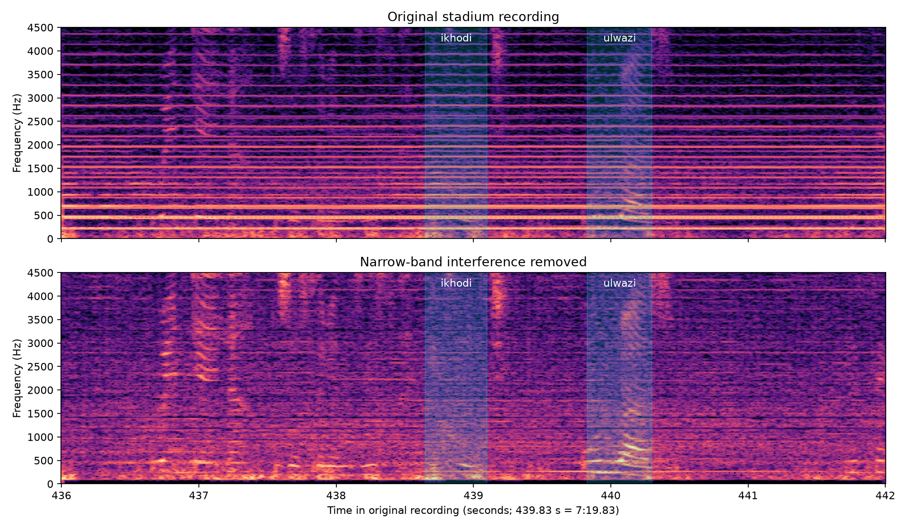

# South Africa Easy — Ngiyakuzwa?

**Flag: `SIGMOID_ULWAZI`**

The relevant phrase is **“uzosebenzisa ikhodi ulwazi”**. The word directly after `ikhodi` is **ulwazi**. In the original recording, `ikhodi` is around **7:18.65–7:19.10** and `ulwazi` is around **7:19.83–7:20.30**. These are approximate CTC alignment times.

## Evidence

- [Cleaned key phrase](outputs/key_phrase_cleaned.wav) — 3.5 seconds, beginning at 7:17.20 in the original.
- [Slower phrase](outputs/key_phrase_slow.wav) — 80% speed, with the corresponding pitch change.
- [Isolated key word](outputs/key_word.wav).
- [Original phrase](outputs/key_phrase_original.wav) for comparison.
- [20-second cleaned context](outputs/key_context_cleaned.wav), beginning at 7:05.
- [Full cleaned recording](outputs/cleaned.wav).
- [Timestamped full transcription](outputs/transcript.json).
- [Recognition comparisons](outputs/key_verification.json) across signal treatments and crop boundaries.
- [Machine-readable result](result.json).



## Method

The input is 630 seconds of mono 16-bit PCM at 16 kHz. Its spectrum contains strong, persistent narrow-band interference. A simple high-pass filter would discard useful speech with the noise.

`analyze_audio.py` instead computes an STFT with an 8192-sample Hann window and 75% overlap. It compares the mean power spectrum with a 61-bin median baseline, marks bins above four times that baseline, and expands the mask by two bins on either side. Marked bins are multiplied by 0.015. Frequencies below 100 Hz are removed; frequencies above 4500 Hz are attenuated. The inverse STFT is peak-normalized to 0.9 and saved as PCM WAV.

The filtered audio is transcribed locally using [badrex/w2v-bert-2.0-zulu-asr](https://huggingface.co/badrex/w2v-bert-2.0-zulu-asr), a model trained for isiZulu. The full transcription uses 20-second windows with 3 seconds of overlap. It locates the code passage near 439 seconds.

For the decisive **437–441 second** crop, the narrow-filtered transcription reads **“ikalela uzosebenzisa ikhodi ulwazi”**. Other crops of this same signal also return `ulwazi`; a 436–442 second crop of the original independently returns `ulwazi` but misrecognizes the preceding keyword. Wider filtering sometimes produces `ukwazi`, and the optional DeepFilterNet pass introduces additional errors. These disagreements are retained in the comparison JSON. The narrow-filtered version is the primary evidence. The [dictionary entry](https://glosbe.com/zu/en/ulwazi) corroborates the spelling `ulwazi`; it was consulted after the audio-based recognition.

The result was recovered locally. No scoring-platform submission or PASS response has been received.

## Reproduce

Use Python 3.11 and run these commands from this folder:

```sh
python3.11 -m venv .venv
.venv/bin/python -m pip install -r requirements.txt
.venv/bin/python analyze_audio.py
.venv/bin/python analyze_audio.py --wide
.venv/bin/python make_evidence.py
```

Download the recognition model once (about 2.3 GB; cached outside the repository):

```sh
.venv/bin/python -c "from huggingface_hub import snapshot_download; snapshot_download('badrex/w2v-bert-2.0-zulu-asr', revision='9855bac28489def178407fb385710e8cc519a87f', allow_patterns=['*.json','*.safetensors','*.txt'])"
.venv/bin/python transcribe.py outputs/cleaned.wav
```

Apple Silicon uses MPS when available; otherwise the scripts use CPU. Transcription loads cached model files and does not upload the recording. Dependency versions in `requirements.txt` record the environment used for this solution.

Optional enhancement comparison, following the [DeepFilterNet project](https://github.com/Rikorose/DeepFilterNet):

```sh
.venv/bin/python -m pip install --no-deps deepfilternet==0.5.6 deepfilterlib==0.5.6 loguru==0.8.0 appdirs==1.4.4 torchaudio==2.11.1 requests==2.34.2 charset-normalizer==3.5.2 certifi==2026.10.23 urllib3==2.8.0
.venv/bin/python enhance_speech.py outputs/key_context_cleaned.wav --output outputs/key_context_enhanced.wav
.venv/bin/python verify_key.py
```

`enhance_speech.py` includes an adapter for the removed torchaudio annotation class used by DeepFilterNet 0.5.6; WAV I/O uses soundfile. Enhancement is a comparison experiment, not a requirement for recovering the flag.

The original `voice_note.wav` is retained unchanged. Its SHA-256 and filter parameters are recorded in [cleaned_metadata.json](outputs/cleaned_metadata.json).
